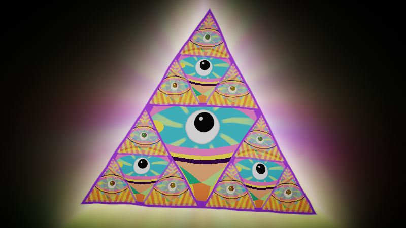
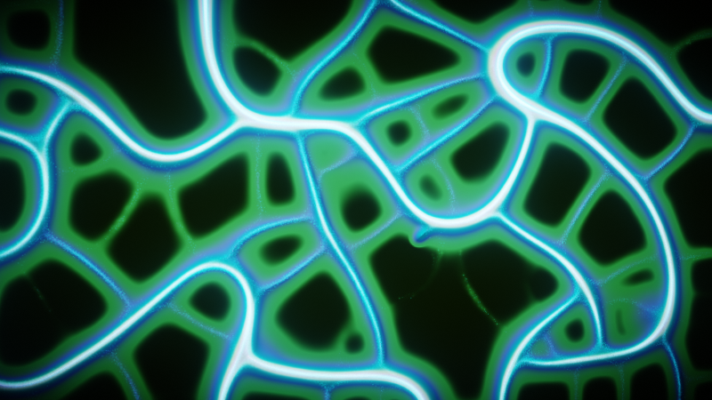
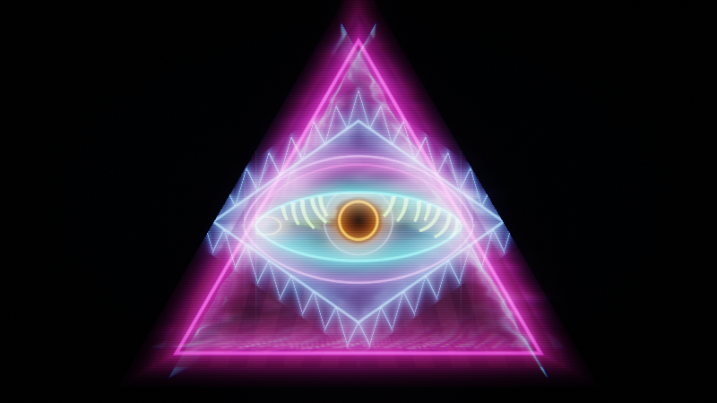
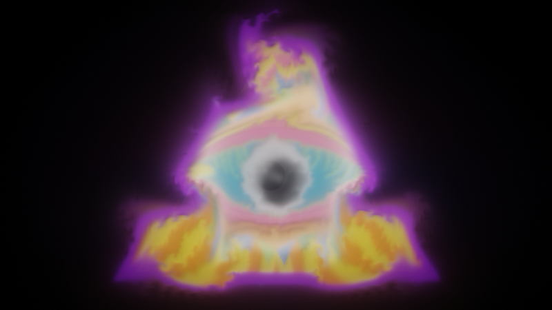
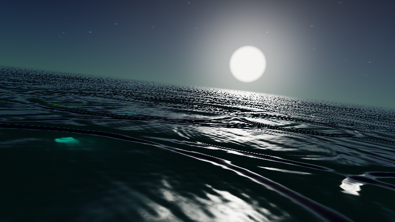
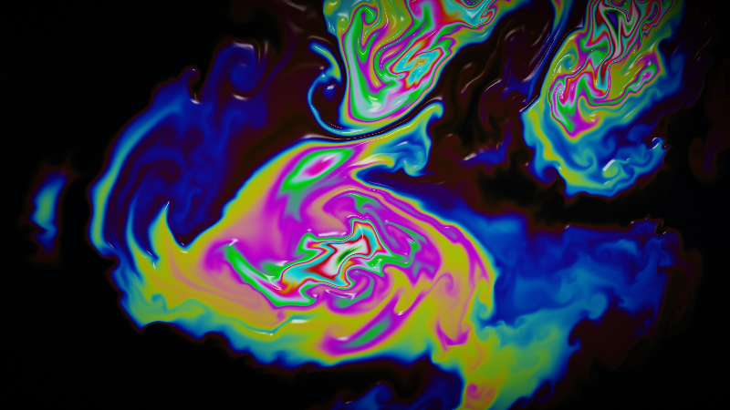
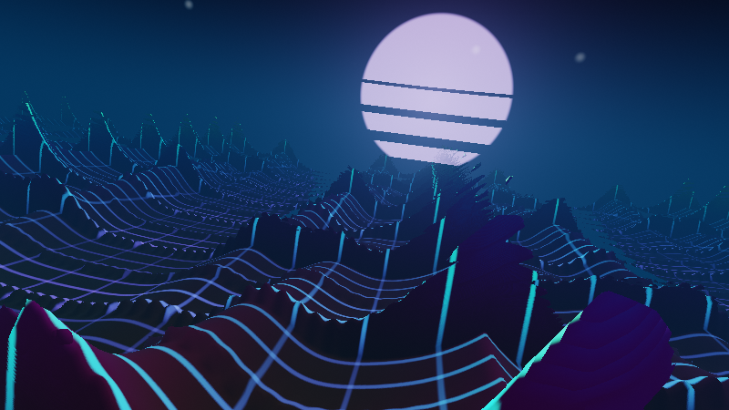
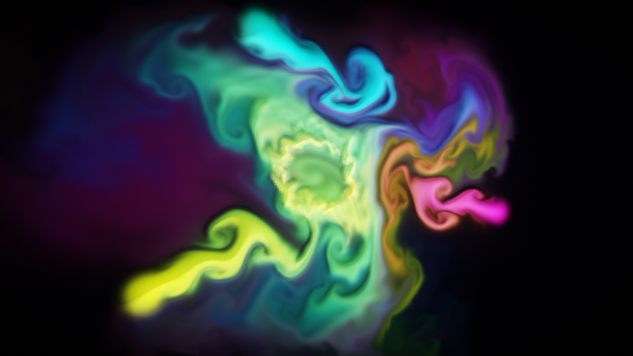

# dsViz

A music visualizer that runs in the browser. It listens to whatever is playing and drives 31 scenes with it: feedback warps in the Milkdrop tradition, fluid, ripple and reaction-diffusion simulation, crowds of GPU agents (slime mould, a starling flock), a fractal dive, and 3D spaces the camera flies through.

Everything is one file, `index.html`. There is nothing to install.

| | |
|---|---|
|  |  |
|  |  |
|  |  |
|  |  |

## Running it

Open `index.html` in Chrome or Edge on a computer, then choose where the music comes from:

- **Capture tab or system audio.** Pick the window, tab or screen that is playing, then tick the "Share audio" box at the bottom of the browser's dialog before confirming. Without that box the visualizer hears nothing; the browser owns the dialog, so the page cannot tick it for you. To skip the dialog altogether, pick a loopback input (Windows "Stereo Mix", or a virtual cable) as the Microphone: dsViz remembers the choice.
- **Play audio files.** Choose files, or drop them anywhere on the page.
- **Microphone.** Listens to the room. Pick which microphone under Settings.
- **Demo beat.** A built-in loop, to see how it reacts.

It needs a browser with WebGL2, and is built for desktop Chrome and Edge. On a phone, choose Microphone or audio files (phones cannot capture another app's audio); swipe across the picture to change scene, and Settings is the tab on the right edge.

## Controls

The control strip appears when you move the mouse and fades when you stop.

| Key | Does |
|---|---|
| Space or → | Next scene |
| ← | Previous scene |
| 1–9, 0 | Jump to scenes 1–10 |
| F, or double-click | Fullscreen |
| L or A | Change scenes automatically, on or off |
| D | Open or close Settings |
| C | Camera movement, on or off |
| V | Move the current scene into its next 3D space |
| R | Random Picture settings: a new look |
| Q | Next Detail level |
| S | Change the audio source |
| Esc | Close Settings or the source card |

The address follows the scene, so a link opens dsViz right there: `#Δ` is Henry, `#Δ/dome` is Henry in the dome, `#Δ2` and `#Δ3` are the other Henrys, and every other scene goes by its name (`#slime-mould`, `#hall-of-mirrors`). Copy link under Settings copies the address; on a phone it opens the share sheet.

## Settings

The Settings drawer (D) holds everything adjustable. Settings are saved in the browser, per address.

- **Sound in:** a live input meter, and the microphone picker.
- **Music:** Intensity, Speed, Beat punch, and separate Bass, Mids and Treble. Random and Default buttons act on the whole section.
- **Picture:** Brightness, Trails, Glow, Saturation, Colour shift, with their own Random and Default.
- **Camera:** how far it moves, whether scenes may wrap into 3D spaces (tunnel, dome, floor), and which space the current scene is in.
- **Detail:** how sharply the picture is rendered. Auto lowers itself if the computer struggles.
- **Scenes:** time per scene, crossfade length, Copy link, and Fav and Hide for each scene. Reset all settings keeps the Fav and Hide lists; Clear Fav and Hide empties them.

## Scenes

1. Plasma Tide
2. Event Horizon
3. Prism Cathedral
4. Aurora Veil
5. Ink Bloom
6. Solar Petals
7. Starforge
8. Neon Horizon
9. Julia Garden
10. Silk Ribbons
11. Velvet Smoke
12. Oil Slick
13. Acrylic Pour
14. Glass Tide
15. Moon Pool
16. Pool Floor
17. Quicksilver
18. Gel Orbit
19. Ridgeline
20. Petri
21. Hall of Mirrors
22. Maelstrom
23. Slime Mould
24. Murmuration
25. Lichtenberg
26. Cathode
27. Deep Field
28. Loom
29. Henry
30. Henry Deux
31. Henry 3

## How it works

Each scene is three things:

- a **warp shader**, which bends the previous frame before the new one is drawn on it;
- a **draw step**, which adds what the music is doing this frame (waveforms, shapes, particles);
- a **composite shader**, which turns that buffer into the picture, seen from a camera.

Some scenes lean on a simulation that runs alongside: a fluid solver whose velocity carries the picture, or a low-resolution buffer running the wave equation or reaction-diffusion. Two scenes run crowds of agents on the GPU, each agent a texel of a float texture: Slime Mould's quarter of a million cells follow and lay down scent in that buffer, and Murmuration's birds read it as the crowd around them.

A scene can live in one of four spaces: flat (the picture on a plane the camera orbits), or wrapped around the camera as a tunnel, a dome or a floor. Which spaces suit which scene is a table in `07-main.js`; a scene with a horizon can set `panorama: true` so the dome keeps its sky up and its ground down.

Henry is different from the rest: a painting rebuilt from scratch in a shader, so that every part of it can move with the music. Henry Deux traces the same shapes as neon over a dark trail, with a pupil that turns toward the loudest band. Henry 3 prints the painting into the fluid solver and lets it melt until the next eighth beat snaps it back.

Sound is analysed into bass, mids and treble, each measured against its own recent average, so a quiet source and a loud one drive the picture equally hard. Kicks and beats are detected from sudden rises in the spectrum.

## Changing it

`index.html` is built from the files in `src/`. Edit those, then rebuild:

```
python3 build.py
```

| File | Holds |
|---|---|
| `shell.html` | Page title, styles and markup |
| `00-config.js` | Settings and their defaults |
| `01-gl.js` | WebGL setup and the shader code every scene shares |
| `02-audio.js` | Audio analysis and beat detection |
| `03-sources.js` | Tab capture, microphone, file playback, demo beat |
| `04-draw.js` | Glowing lines and shapes |
| `04b-fluid.js` | Fluid solver and the camera |
| `04c-agents.js` | GPU agents: a float texture of positions, updated and drawn by each scene's shaders |
| `05-presets-a.js` to `06f-presets-g.js` | The scenes |
| `06g-henry.js` | Henry, and the shapes the other two Henrys share |
| `06h-henry-deux.js` | Henry Deux |
| `06i-henry-3.js` | Henry 3 |
| `07-main.js` | Render loop and scene switching |
| `08-ui.js` | Controls and the Settings drawer |

The `.js` files are joined in name order, so the numeric prefixes set the order.
